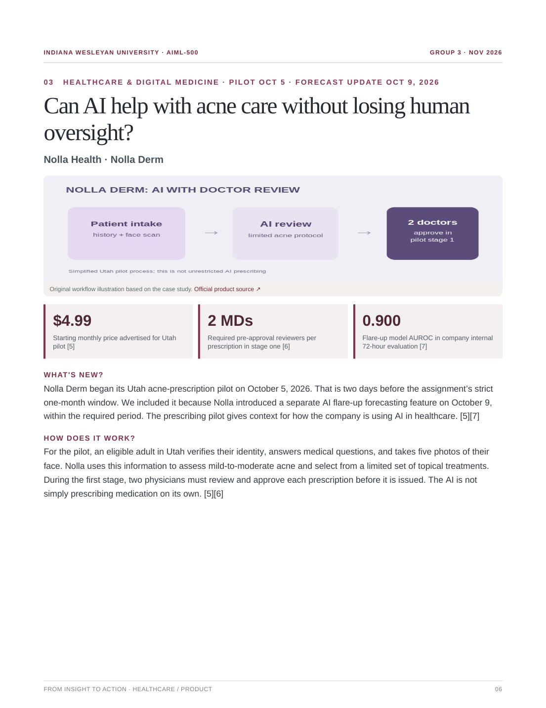
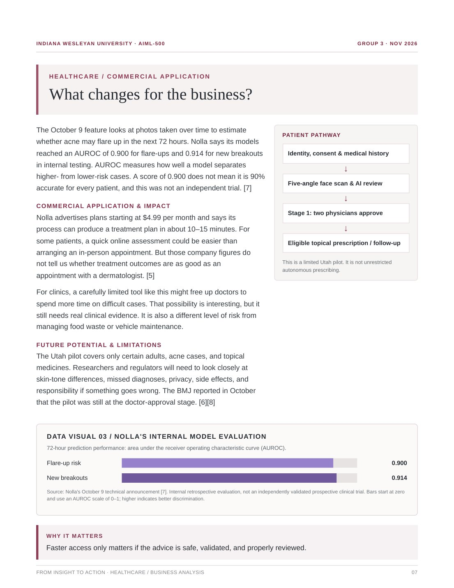

## Read the Newsletter

```{=html}
<div class="embed">
  <iframe src="assets/ai-business-newsletter-group3.pdf" title="From Insight to Action: AI Business Newsletter, Group 3"></iframe>
</div>
```

[Download the full newsletter (PDF)](assets/ai-business-newsletter-group3.pdf){download="Group3_AI_Business_Newsletter.pdf"} · My section is the healthcare case study on **pages 6–7**.

## Introduction

New AI health products often arrive with impressive numbers: a low monthly price, a fast treatment plan, a high model score. For a health program, the hard part is knowing what those numbers do and do not show before trusting the tool with patients.

This artifact comes from *From Insight to Action*, a nine-page newsletter my AIML-500 group wrote about three AI products launched in October 2026, in food service, logistics, and healthcare. **I researched and wrote the healthcare case study**: Nolla Health's AI-assisted acne care pilot in Utah.

## Description

The newsletter explains what each product does, how it could change business decisions, and what evidence is still missing. My healthcare section covers:

- **What's new:** Nolla Derm's Utah acne-prescription pilot (October 5, 2026) and its AI flare-up forecasting feature (October 9, 2026).
- **How it works:** identity check, medical questions, a five-angle face scan, AI review, and, in the pilot's first stage, approval of each prescription by two physicians.
- **Commercial impact:** faster, cheaper access for patients and possibly more doctor time for difficult cases, set against the lack of independent clinical evidence.
- **Limitations:** skin-tone differences, missed diagnoses, privacy, side effects, and who is responsible if something goes wrong.

```{=html}
<div class="stats">
  <div class="stat"><b>3</b><span>industries compared: food, logistics, healthcare</span></div>
  <div class="stat"><b>8</b><span>cited sources, including a state regulator and <i>The BMJ</i></span></div>
  <div class="stat"><b>10</b><span>dropped-text errors found and fixed for this portfolio version</span></div>
</div>
```

### Reading the claims carefully

The core of my section is separating what the company reports from what has actually been shown:

| Company claim | What the evidence actually shows |
|:-----------------|:---------------------------------------|
| Flare-up model AUROC of 0.900 | AUROC measures how well a model ranks higher-risk above lower-risk cases. It does **not** mean the model is 90% accurate for every patient, and the result comes from an internal, retrospective evaluation, not an independent clinical trial. |
| Plans from $4.99 per month; a treatment plan in about 10–15 minutes | Advertised by the company. These figures say nothing about whether outcomes match a visit with a dermatologist. |
| "AI prescriptions" | A limited Utah pilot: certain adults, mild-to-moderate acne, a small set of topical treatments, and two physicians approving each prescription in stage one. It is not autonomous prescribing. |

::: {layout-ncol=2}



:::

### What this means for global health

The questions I asked about Nolla are the same ones an HIV or global health program should ask before adopting any AI tool. Was the model tested independently, or only by the company? Does a high score hold across the populations the program serves, including people with darker skin tones? Who reviews the AI's output, and who is accountable when it is wrong? A tool that performs well in one setting may not transfer to clinics in sub-Saharan Africa without local validation.

## Objective

To analyze a real, newly launched AI product in healthcare and explain its business value and its risks in plain language for a business audience, while reading model performance metrics correctly instead of repeating company claims.

## Process

1. **Chose the case within the assignment window.** Our group was asked to cover AI products launched within one month. The Nolla pilot started two days before the window, so we included it because the October 9 flare-up forecasting feature fell inside it, and we stated this openly in the newsletter.
2. **Gathered evidence from different types of sources.** I used Nolla's own announcements for product facts, the Utah Department of Commerce for the pilot's authorized scope and oversight, and *The BMJ* for independent reporting on physician oversight.
3. **Interpreted the model metrics.** I explained AUROC for non-technical readers and labeled the 0.900 and 0.914 results as internal, retrospective evaluations.
4. **Mapped the human oversight.** I summarized the patient pathway (intake, face scan and AI review, two-physician approval, prescription) to show where people stay in control.
5. **Integrated with the group.** Our group combined the three case studies into one newsletter with a shared structure and a cross-industry comparison of how much human review each use of AI needs.
6. **Revised for this portfolio.** I found that the PDF export had silently dropped emphasized text in ten places. In my section, one sentence's meaning was reversed: it read that an AUROC of 0.900 "does mean" 90% accuracy. I restored the missing text across the newsletter and corrected that sentence.

## Tools and Technologies Used

- **Primary sources**: Nolla Health announcements, the Utah Department of Commerce AI pilot program, and *The BMJ*.
- **ML evaluation concepts**: AUROC and the difference between internal retrospective testing and independent prospective trials.
- **Generative AI**: used by our group to support research synthesis and the newsletter's HTML design, as disclosed in the newsletter.
- **HTML and PDF**: newsletter layout and export.
- **Quarto and GitHub Pages**: publishing this portfolio page.

## Value Proposition

### Unique Value

I can look past the headline numbers of an AI health product and explain what they really mean. In this case study I showed that a high AUROC is not the same as accuracy, that a company's internal test is not a clinical trial, and that "AI prescribing" was in practice a narrow pilot with two doctors approving every prescription. I explain this in language that business and program decision-makers can follow.

### Relevance

Health programs are approached by vendors with AI tools and promising metrics. Being able to ask the right questions about validation, fairness across populations, human oversight, and accountability helps programs avoid tools that look strong on paper but have not been proven for the people they serve. This connects directly to my goal of helping global health programs adopt AI that is evidence-based and safe.

## References

- Nolla Health. (2026, October 5). [*Nolla's Utah prescription pilot announcement*](https://www.nollahealth.com/blog/ai-prescriptions-utah).
- Nolla Health. (2026, October 9). [*Acne flare-up forecasting: Model description and internal evaluation*](https://www.nollahealth.com/blog/mapping-how-skin-changes).
- Utah Department of Commerce. (n.d.). [*Authorized AI pilots: Nolla Health*](https://commerce.utah.gov/ai/regulatory-relief-4/authorized-pilots/).
- *The BMJ*. (2026, October 19). [*Report on physician oversight in Nolla's pilot*](https://www.bmj.com/content/395/bmj-2026-101186).
- Group 3 (Sultan, A., Uppuluri, J., Punyamurthula, K. S., Sun, Y., & Gu, Y.). (2026). *From insight to action: How AI is changing food operations, fleet management, and healthcare decisions* [Course newsletter]. AIML-500, Indiana Wesleyan University.

[← Back to home](index.qmd)
